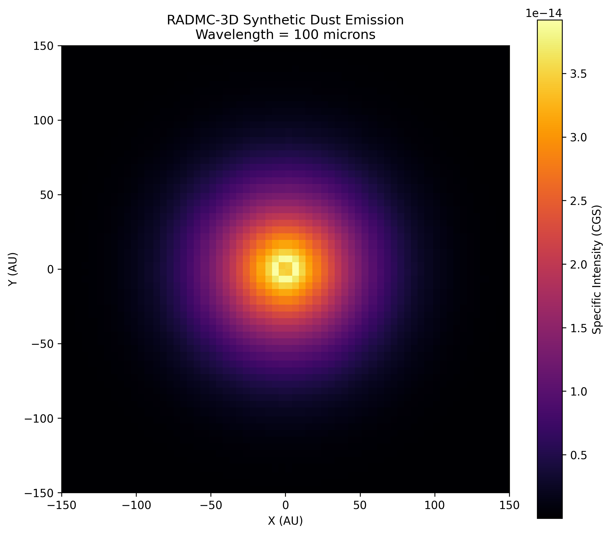
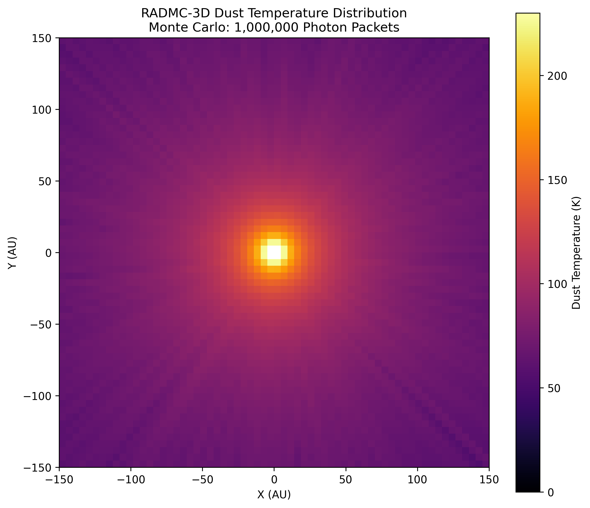
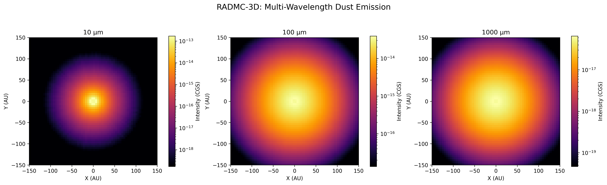

This image shows the simulated thermal emission
from a three-dimensional dust cloud at 100 microns,
calculated using RADMC-3D.

# RADMC-3D: Interstellar Dust Simulation

## Overview
A three-dimensional dust radiative transfer simulation using RADMC-3D and Python.

This project investigates how radiation from a solar-like star heats a surrounding Gaussian dust cloud and produces thermal infrared emission.

## Simulation Parameters
- Grid: 64 × 64 × 64 cells
- Density model: Gaussian distribution
- Radiation source: Solar-like star (5772 K)
- Method: Monte Carlo Radiative Transfer
- Photon packets: 100,000 and 1,000,000
- Synthetic image wavelength: 100 μm

## Preliminary Results
- Maximum dust temperature: approximately 226.46 K
- Zero-temperature dust cells reduced from 51 to 0
- Synthetic thermal emission image generated at 100 μm

## Tools
- RADMC-3D
- Python
- NumPy
- Matplotlib
- Google Colab

## Scientific Limitations
This is an educational proof-of-concept simulation. Dust opacity is simplified, and further convergence testing and physical validation are needed before using the results for research conclusions.

## Future Work
- Clumpy and filamentary dust structures
- Realistic dust opacity models
- Multi-wavelength synthetic observations
- Quantitative analysis of dust temperature and emission
## Simulation Results

### Synthetic Dust Emission at 100 Microns
## Simulation Results

### 1. Dust Temperature Distribution

The dust temperature distribution was calculated using the RADMC-3D Monte Carlo radiative transfer method.

The simulation shows radiative heating of the surrounding dust by a central solar-like star. Dust temperatures generally decrease with increasing distance from the radiation source.

### 2. Synthetic Thermal Dust Emission at 100 μm

This synthetic image represents the modeled thermal dust emission at a wavelength of 100 μm.

### 3. Multi-Wavelength Dust Emission

Synthetic emission maps were generated at three wavelengths:

- **10 μm:** Emission is concentrated toward the warmer central region.
- **100 μm:** The emission extends over a larger region.
- **1000 μm:** The modeled emission appears more spatially extended.

These results demonstrate the wavelength dependence of thermal dust emission within the adopted model.

### Scientific Limitations

This is an educational proof-of-concept simulation. The dust density distribution is prescribed rather than dynamically evolved, and the dust opacity model is simplified. Further numerical convergence tests and physical validation are required before drawing research-level conclusions.
